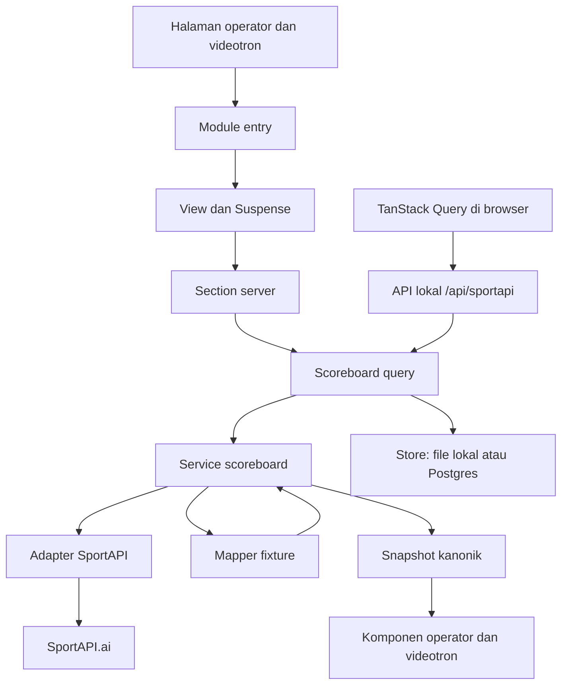

# Data flow scoreboard

Mengikuti kontrak `docs/architecture/data-flow.md` dari `srikandi-merdeka-cup`. App ini melayani satu fixture. App bisa berjalan sebagai satu proses Next.js lokal atau sebagai beberapa instance Vercel yang berbagi Neon Postgres.

| Layer | Tanggung jawab |
| --- | --- |
| `src/app` | Route dan metadata halaman. Endpoint membaca JSON kontrol dan mengembalikan respons HTTP. |
| `src/modules/scoreboard` | Entry, view dan section membentuk halaman. Kedua halaman memakai query yang sama dengan endpoint. |
| `queries` | Memilih store, mengambil lease polling, dan menjalankan pengecekan SportAPI lewat `after()` setelah respons terkirim. |
| `stores` | `postgres-store` untuk Vercel: lease atomik lewat `next_check_at` dan row lock untuk kontrol operator. `file-store` untuk PC vMix: state di memori dan `.scoreboard/`. |
| `src/db` | Skema Drizzle, migrasi, dan pool `pg` ke URL pooled Neon. |
| `services` | Menemukan fixture, memvalidasi envelope dan identitas, memiliki kebijakan polling, serta menyimpan skor otomatis dan manual. |
| `api` | Menentukan endpoint SportAPI dan mengirim `X-Api-Key` dari server. |
| `mappers` | Mengubah respons fixture menjadi skor, status dan menit kanonik. |
| `lib`, `types`, `components` | Konfigurasi laga, kontrak snapshot, serta query dan mutasi TanStack untuk tampilan dan kontrol melalui API lokal. |
| `src/components/shadcn` dan `src/components/shadcn-extend` | CLI shadcn memasang komponen dasar di folder pertama. Buat kustomisasi di folder kedua dengan utility Tailwind langsung di `className`. CSS global berisi konfigurasi Tailwind dan token tema. |

Service tidak menyimpan state sendiri. Service menghitung hasil polling dan aksi operator, lalu store menyimpannya. Hasil polling hanya menulis kolom feed, dan aksi operator hanya menulis `mode` dan `manual`, sehingga keduanya tidak saling menimpa. Dengan `DATABASE_URL`, state ada di satu baris Postgres per laga. Tanpa itu, state dicatat ke `.scoreboard/` agar mode manual dan skor kembali setelah restart. Browser mengambil snapshot dari `/api/sportapi` tiap 2 detik dan tetap menampilkan halaman yang sama. Panel operator berhenti polling ketika tab disembunyikan dan kembali mengecek saat tab aktif.

Mutasi kontrol langsung menulis snapshot yang dikembalikan server ke cache TanStack Query. Cache membandingkan revisi pada setiap snapshot dengan `instance` yang sama agar hasil polling yang terlambat tidak mengembalikan skor ke versi lama.

Jeda bawaan ke SportAPI adalah 6 detik saat live dan 30 detik sebelum laga atau saat HT. Bila feed menyatakan laga selesai, polling berhenti. HTTP `429` mengikuti `Retry-After`. Fixture yang belum ditemukan, data skor yang masih kosong, dan kegagalan feed memiliki status yang berbeda di operator. Mode manual tetap aktif sampai operator memilih kembali ke otomatis.
